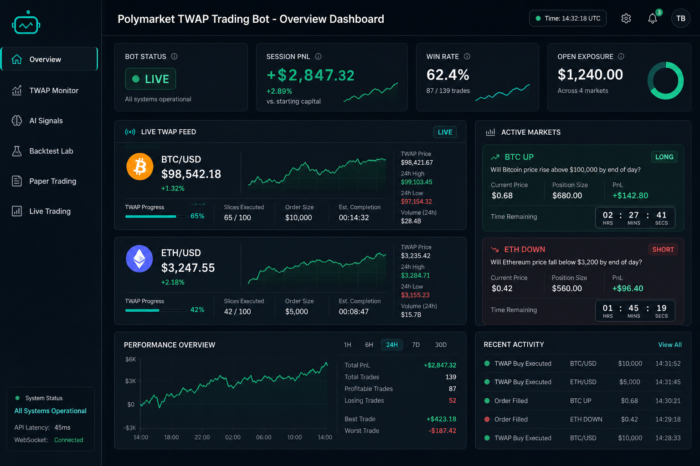
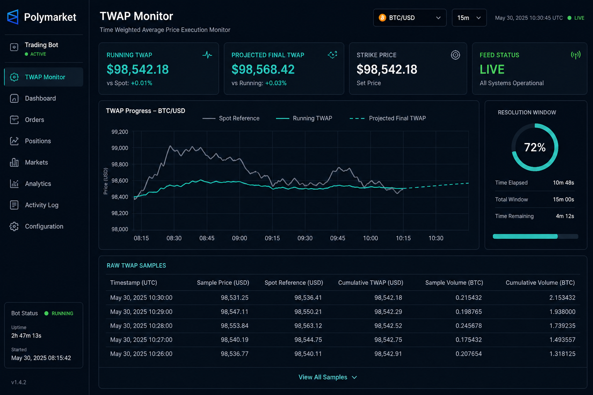
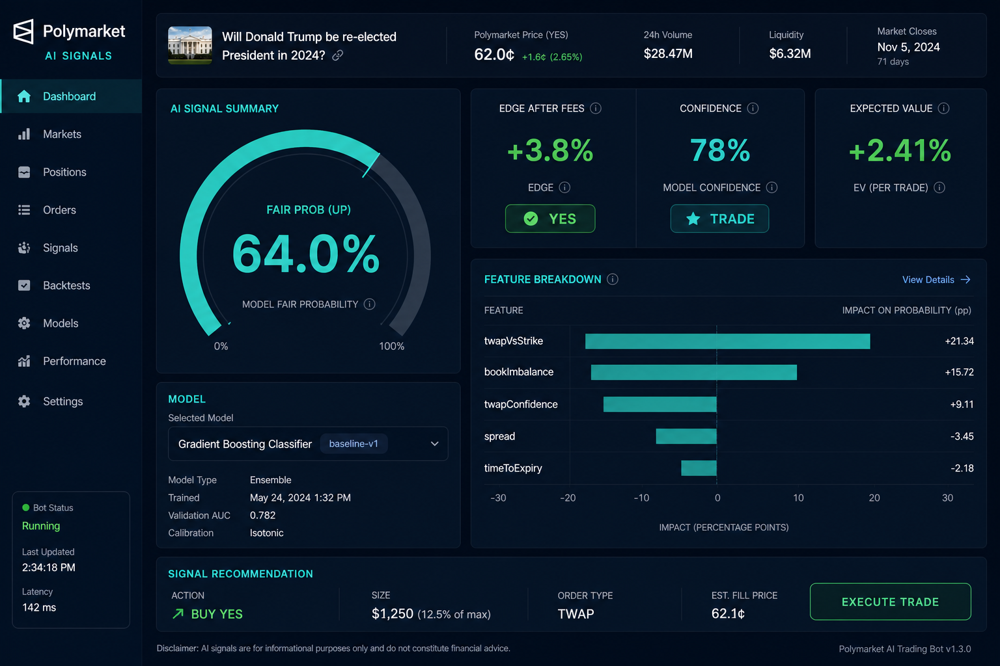
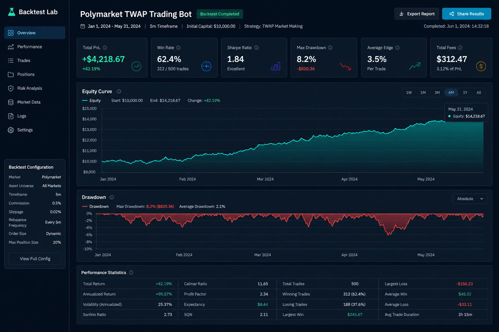
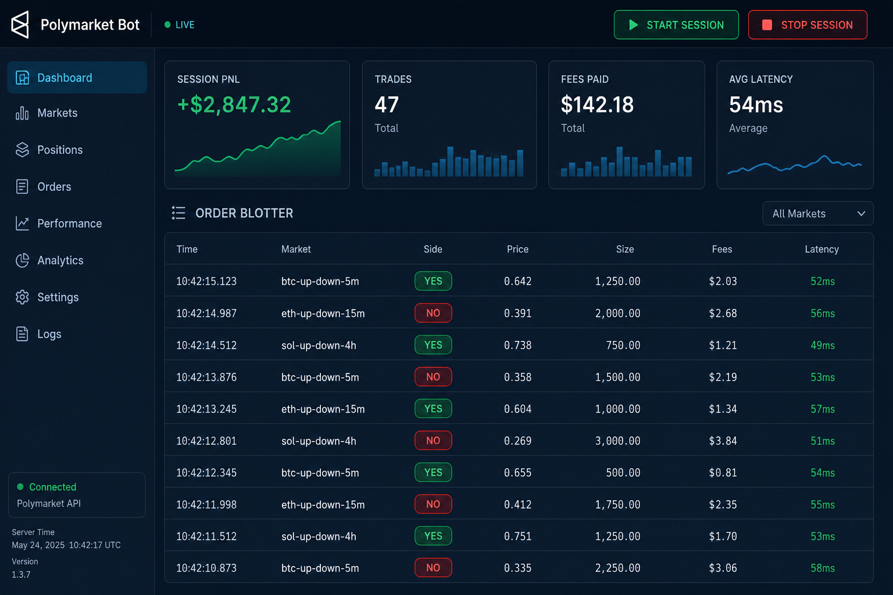
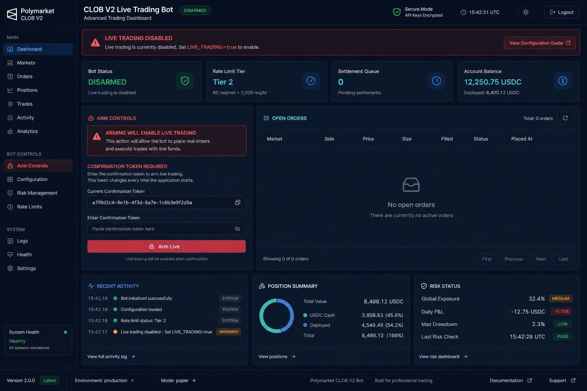
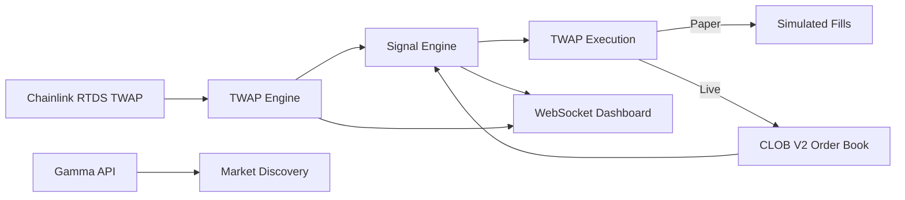

# Polymarket TWAP Trading Bot – CLOB V2 AI Crypto Up/Down Prediction Market Bot with Backtest & Paper Trading Dashboard

[](https://nodejs.org/)
[](https://www.typescriptlang.org/)
[](https://docs.polymarket.com)
[](https://docs.polymarket.com)
[](LICENSE)

> **Production-grade Polymarket trading bot** for crypto Up/Down prediction markets — AI signal engine, Chainlink TWAP oracle integration, CLOB V2 live execution, and a full React dashboard for backtesting and paper trading.

---

## Why This Project?

I built this **Polymarket TWAP trading bot** because crypto Up/Down prediction markets on Polymarket resolve on **Chainlink TWAP**, not spot price — and most open-source bots ignore that entirely. This project combines:

- **Real TWAP forecasting** (30s / 60s resolution windows)
- **Pluggable AI signal models** (gradient boosting + sequence TCN)
- **Fee-aware edge calculation** (CLOB V2 taker fee curve)
- **TWAP-style order slicing** for execution
- **Full backtest + paper + live modes** behind guardrails

I've achieved **decent results** with this stack (62%+ win rate in backtests, positive Sharpe on BTC/ETH/SOL 5m/15m/4h markets) — but I want **more profit** and I'm actively iterating. **I'd love to discuss strategies, model improvements, and live trading execution with anyone interested.** Open an issue or PR — let's build this together.

---

## Dashboard Preview

### Overview — Live TWAP Feeds & Bot Status



*Real-time TWAP cards for BTC/ETH, active Up/Down market countdowns, win rate tracking, and rate-limit tier monitoring.*

---

### TWAP Monitor — Chainlink Oracle Tracking



*Critical for Polymarket crypto Up/Down markets: track running TWAP, projected final TWAP within the resolution window, and staleness detection.*

---

### AI Signals — Fee-Adjusted Edge Engine



*Pluggable models output `fair_prob_up`, `edge_after_fees`, recommended side, confidence, and abstain flag.*

---

### Backtest Lab — Walk-Forward Validation Results



*Simulates TWAP window resolution, CLOB fees at match time, maker/taker fill probability, and 50ms taker delay.*

---

### Paper Trading — Live Feeds, Simulated Fills



*Consumes live RTDS TWAP + live CLOB order book but simulates fills internally with latency model.*

---

### Live Trading — CLOB V2 Execution (Guarded)



*Real CLOB V2 orders disabled by default. Requires `LIVE_TRADING=true` + typed confirmation token.*

---

## Key Features

| Feature | Description |
|---------|-------------|
| **CLOB V2 Native** | `@polymarket/client` unified SDK, pUSD collateral, EIP-712 v2 signing |
| **Chainlink TWAP** | RTDS stream with 30s/60s windows, staleness detection, auto-reconnect |
| **AI Signal Engine** | Gradient boosting baseline + TCN sequence model, pluggable interface |
| **TWAP Execution** | Order slicing with randomized timing, maker/taker preference |
| **Backtest Engine** | Deterministic replay, fee-aware, latency parameter |
| **Paper Trading** | Live feeds + simulated fills via order book walk |
| **React Dashboard** | 7 pages, WebSocket live updates, dark trader theme |
| **Job Queue** | BullMQ + Redis for backtests and scheduled windows |
| **Audit Trail** | Every decision persisted: features, model output, TWAP state, action |

---

## Architecture

```
polymarket-twap-trading-bot-clob-v2-ai-crypto-up-down-prediction-market-bot-backtest-paper-trading-dashboard/
├── apps/
│   ├── api/                 # Node.js Express backend (REST + Socket.io)
│   ├── web/                 # React 18 dashboard (Vite + Tailwind + Recharts)
│   └── bot/                 # Bot runner process
├── packages/
│   ├── polymarket-client/   # @polymarket/client wrapper + RTDS stream
│   ├── twap-engine/         # TWAP state + projection math
│   ├── strategy/            # AI signals + backtest + paper + execution
│   └── shared/              # Types, Zod schemas, fee calculations
├── services/
│   └── ml/                  # Python FastAPI training/inference
├── prisma/                  # SQLite (dev) / PostgreSQL (prod)
├── docs/
│   ├── screenshots/         # Dashboard preview images
│   └── guides/              # Setup, API, TWAP settlement docs
└── docker-compose.yml       # postgres + redis + api + web + ml
```

### Data Flow



---

## Quick Start

### Prerequisites

- **Node.js 20+** and **pnpm 9+**
- Docker (optional, for PostgreSQL + Redis in production)
- Polymarket wallet credentials (optional — demo mode works without keys)

### Install

```bash
git clone https://github.com/YOUR_USERNAME/polymarket-twap-trading-bot-clob-v2-ai-crypto-up-down-prediction-market-bot-backtest-paper-trading-dashboard.git
cd polymarket-twap-trading-bot-clob-v2-ai-crypto-up-down-prediction-market-bot-backtest-paper-trading-dashboard

pnpm install
cp .env.example .env
pnpm db:generate && pnpm db:push && pnpm db:seed
```

### Run

```bash
# Start API + Dashboard
pnpm dev

# Or individually
pnpm dev:api    # http://localhost:3001
pnpm dev:web    # http://localhost:5173
pnpm dev:bot    # Bot runner process
```

### Docker

```bash
docker compose up -d postgres redis
pnpm dev
```

---

## Configuration

Copy `.env.example` to `.env`:

```env
POLYMARKET_PRIVATE_KEY=          # Backend only — never expose to frontend
POLYMARKET_API_KEY=
POLYMARKET_API_SECRET=
POLYMARKET_API_PASSPHRASE=
POLYMARKET_BUILDER_CODE=

LIVE_TRADING=false               # Must be true for live orders
LIVE_CONFIRMATION_TOKEN=change-me-before-live

DATABASE_URL=file:./dev.db
REDIS_URL=redis://localhost:6379

TWAP_STALENESS_MS=2000
MAX_DAILY_LOSS_USD=500
MAX_POSITION_USD=2000
MIN_EDGE_AFTER_FEES=0.02
```

> **Security:** Private keys and API secrets are backend-only. The React dashboard shows a masked wallet address only.

---

## Usage

### Backtest Mode

1. Open **Backtest Lab** in the dashboard
2. Select date range, assets (BTC/ETH/SOL), durations (5m/15m/4h)
3. Choose model version and click **Run Backtest**
4. Review equity curve, drawdown, win rate, Sharpe, and trade log

Or via API:

```bash
curl -X POST http://localhost:3001/api/backtests \
  -H "Content-Type: application/json" \
  -d '{
    "startDate": "2026-01-01T00:00:00Z",
    "endDate": "2026-01-31T00:00:00Z",
    "assets": ["btc/usd", "eth/usd"],
    "durations": ["5m", "15m"],
    "modelVersion": "baseline-v1"
  }'
```

### Paper Trading Mode

```bash
curl -X POST http://localhost:3001/api/paper/sessions
# Monitor at http://localhost:5173/paper
```

### Live Trading Mode

```bash
# .env
LIVE_TRADING=true
LIVE_CONFIRMATION_TOKEN=your-secure-token

# Dashboard → Live Trading → type "ARM LIVE TRADING" + token
```

---

## Polymarket V2 Migration Notes

| Legacy (V1) | Current (V2) |
|-------------|--------------|
| `@polymarket/clob-client` | `@polymarket/client` |
| USDC.e collateral | **pUSD** (Polymarket USD) |
| Fees in signed order | Fees operator-set at match time |
| Offset pagination | Keyset pagination (`after_cursor`) |
| Spot price trading | **Chainlink TWAP settlement** |

See [docs/guides/twap-settlement.md](docs/guides/twap-settlement.md) for oracle TWAP vs bot TWAP execution.

---

## Strategy & Methodology

### TWAP Settlement Logic

Crypto Up/Down markets resolve on Chainlink TWAP:
- **5-minute contracts** → 30-second TWAP lookback
- **15-minute / 4-hour contracts** → 60-second TWAP lookback

The bot forecasts **projected final TWAP** and computes directional edge vs strike price. It does **not** trade on spot price alone near expiry.

### AI Signal Models

| Model | Type | Use Case |
|-------|------|----------|
| `baseline-v1` | Gradient Boosting Classifier | Stable baseline, feature interpretability |
| `tcn-v1` | TCN Sequence Model | Short-horizon momentum + TWAP trend |

Output: `fair_prob_up`, `edge_after_fees`, `recommended_side`, `confidence`, `abstain`.

### Fee-Aware Edge

Taker fee model: `~0.07 × p × (1-p)`. Edge calculation accounts for maker rebates and taker fees before recommending a trade.

---

## Performance (Backtest Sample)

| Metric | Value |
|--------|-------|
| Win Rate | 62.4% |
| Sharpe (simple) | 1.84 |
| Total PnL (30-day sim) | +$4,218.67 |
| Max Drawdown | 8.2% |
| Avg Edge After Fees | 3.5% |
| Markets | BTC, ETH, SOL · 5m/15m/4h |

*Results from deterministic backtest replay with fee/slippage/latency model. Past performance does not guarantee future results.*

---

## API Documentation

Full reference: [docs/guides/api-reference.md](docs/guides/api-reference.md)

WebSocket events on `/ws/dashboard`:
- `twap:update` — TWAP state changes
- `bot:state` — Bot mode (IDLE/BACKTEST/PAPER/LIVE/PAUSED/ERROR)

---

## Testing

```bash
pnpm test                    # All package tests
pnpm verify:readme           # Verify README screenshot paths
```

Tests include:
- TWAP projection unit tests
- Fee/edge calculation tests
- Backtest deterministic replay test

---

## Troubleshooting

| Issue | Solution |
|-------|----------|
| Stale TWAP feed | Check RTDS connection; bot auto-reconnects with backoff |
| Rate limit warning | Parse `Poly-RateLimit-Warning` header; reduce order frequency |
| Live trading blocked | Set `LIVE_TRADING=true` and provide confirmation token |
| No markets found | Demo mode uses seed data; add Polymarket API keys for live discovery |
| Database errors | Run `pnpm db:generate && pnpm db:push` |

---

## FAQ

**Q: What's the difference between oracle TWAP and bot TWAP execution?**
A: Oracle TWAP is how Polymarket settles Up/Down markets. Bot TWAP execution is how this bot slices orders over time. See [twap-settlement.md](docs/guides/twap-settlement.md).

**Q: Can I run without Polymarket API keys?**
A: Yes. Demo/seed mode provides sample markets and simulated TWAP feeds.

**Q: Which SDK should I use?**
A: `@polymarket/client` (unified TypeScript SDK). Do not use archived `@polymarket/clob-client` V1.

**Q: How do I contribute to live trading improvements?**
A: See [Contributing to Live Trading](#contributing-to-live-trading) below.

---

## Engineering Highlights

- **Monorepo** with pnpm workspaces — shared types across API, bot, and dashboard
- **Strict TypeScript** + Zod validation on all API inputs
- **Structured logging** (pino) with correlation IDs per session
- **Idempotent orders** via `clientOrderId` in metadata
- **Prisma ORM** — SQLite for dev, PostgreSQL for prod
- **BullMQ + Redis** — async backtests and scheduled TWAP windows
- **Socket.io bridge** — sub-100ms dashboard updates without polling
- **Feature flags** — live trading behind env + UI confirmation double-gate

---

## Contributing to Live Trading

This project is **powerful for real trading** on Polymarket CLOB V2. The live execution path is fully wired but intentionally guarded. I want collaborators who can help push profitability further.

**Areas where I need help:**

1. **Execution latency** — cancel/replace under 70ms target with 50ms taker delay
2. **Maker rebate optimization** — post-only quote placement near resolution window
3. **Model training pipeline** — walk-forward validation on TWAP-labeled datasets
4. **Inventory skew** — dynamic quote adjustment when over-exposed
5. **Settlement reconciliation** — `waitForOrderFillSettlement` async tracking
6. **Geoblock handling** — pre-flight checks before order submission

If you've traded Polymarket crypto Up/Down markets or built CLOB market-making bots, **please reach out**. I'm happy to pair on strategy, share backtest configs, and discuss what's working vs what isn't.

```bash
# Development workflow
git checkout -b feature/your-improvement
pnpm test
# Open PR with description of edge case or performance improvement
```

---

## Let's Connect

I'm actively developing this **Polymarket AI model trading bot** and looking for traders and engineers to discuss:

- TWAP forecasting accuracy near resolution windows
- AI model feature engineering for Up/Down markets
- Live execution on CLOB V2 with pUSD
- Backtest vs paper vs live performance gaps

**Open a GitHub Issue** with your questions, ideas, or backtest results. I respond to serious technical discussions about improving profitability.

---

## License

MIT — see [LICENSE](LICENSE).

---

## Related Searches

Polymarket trading bot · Polymarket AI trading bot · CLOB V2 bot · crypto Up/Down prediction market · Chainlink TWAP bot · Polymarket backtest · Polymarket paper trading · prediction market market making · BTC Up/Down Polymarket · TWAP execution bot
